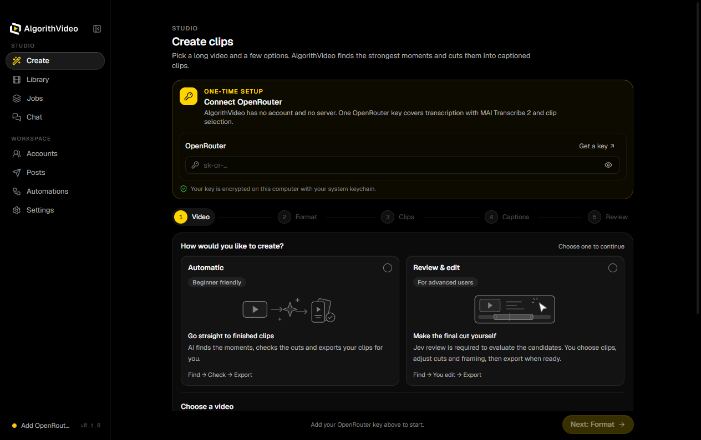

<h1 align="center">
  <picture>
    <source media="(prefers-color-scheme: dark)" srcset="resources/algorithvideo-logo.svg" />
    <source media="(prefers-color-scheme: light)" srcset="resources/algorithvideo-logo-light.svg" />
    
  </picture>
</h1>
<p align="center"><strong>Turn long videos into your next story.</strong><br />An open-source video clipping desktop app maintained by <a href="https://github.com/algorithco">Algorithco</a>.</p>
<p align="center">
  <a href="https://github.com/algorithco/algorith-video/actions/workflows/ci.yml"></a>
  <a href="LICENSE"></a>
  
</p>
<p align="center"><a href="docs/README.md">Documentation</a> · <a href="CONTRIBUTING.md">Contribute</a> · <a href="https://github.com/algorithco/algorith-video/issues/new/choose">Report a bug or request a feature</a> · <a href="SECURITY.md">Security</a></p>

AlgorithVideo turns podcasts, interviews, tutorials and streams into short clips with captions. Import a local video or a supported public link, let AI find candidate moments, refine the result and render on your own computer.

**Current version: 0.1.0.** The desktop release workflow builds Windows, macOS and Linux packages on native GitHub Actions runners. This repository contains the Electron app, Python engine, tests and release tooling. Code signing, macOS notarization and automatic updates are not configured for this first release.

## Download the desktop app

Open [GitHub Releases](https://github.com/algorithco/algorith-video/releases/latest) and choose the package for your system. The release workflow produces:

| System | Architecture | Package |
| --- | --- | --- |
| Windows | x64 | `.exe` installer |
| macOS | Apple Silicon / arm64 | `.dmg` and `.zip` |
| macOS | Intel / x64 | `.dmg` and `.zip` |
| Linux | x64 | `.AppImage` and `.deb` |

Packages include Python, FFmpeg, ffprobe and yt-dlp; development tools are not needed to run them. The first packages are unsigned; macOS bundles use ad-hoc signing and are not notarized. Operating systems may show an unverified-publisher warning. Published assets include SHA-256 checksums. See the [release guide](docs/RELEASING.md) for verification and release status details.



## What you can do

- Import a local video, public YouTube video or completed Twitch VOD.
- Find complete moments automatically or review and refine candidates in the clip editor.
- Export vertical 9:16 or horizontal 16:9 video with face-aware framing and nine caption styles.
- Trim, split, adjust crops and captions, remove dead air and change playback speed.
- Organize runs and exports in Library; track bookmarks and posted status.
- Use the assistant with your own supported Claude, ChatGPT or OpenRouter account.
- Optionally connect Zernio for social publishing, queues and automations.

## Get started from source

Install Git, Node.js 22 or a newer version supported by the dependencies (CI uses Node.js 24), Python 3.12, and FFmpeg/ffprobe with the libass `ass` caption filter. In PowerShell:

```powershell
git clone https://github.com/algorithco/algorith-video.git
cd algorith-video
npm ci
python -m venv engine/.venv
engine/.venv/Scripts/python.exe -m pip install --require-hashes -r engine/requirements.lock
npm run dev
```

Development detects `engine/.venv` and media tools in `engine-bin/`; otherwise it checks `PATH`. Open **Settings → System check** to verify the tools, then add your OpenRouter API key in **Settings → API keys**. Real AI jobs need provider credit. Mocked tests do not need real accounts or keys. See the [development guide](docs/development.md) for checks and troubleshooting.

To make your first clips:

1. Choose a local video, public YouTube video or completed Twitch VOD.
2. Select **Automatic** for finished clips or **Review & edit** to refine candidates before exporting.
3. Choose the output format, caption style and model preset, then generate.
4. Review the result in Library. Connect Zernio only if you want social publishing.

## Privacy and provider accounts

**Rendering is local; AI processing uses external services.** Choosing a local video does not keep its audio entirely on your computer.

| Feature | Account needed | What leaves your computer |
| --- | --- | --- |
| Transcription and clip planning | OpenRouter | Audio, transcript text and the relevant AI instructions |
| AI framing or visual analysis | OpenRouter | Sampled video frames when that feature is used |
| Jev review and optional web research | OpenRouter | Transcript excerpts or public source metadata, depending on the feature |
| Built-in assistant | Your selected Claude, ChatGPT or OpenRouter account | Conversation context and app data read through assistant tools |
| Social publishing and automations | Zernio | Selected clips, captions, account targets and publishing options |

Provider keys are stored with your operating system's secure storage and entered in the app. YouTube previews, downloads and web tools also make network requests. Jev review, additional visual context and source research are optional in Settings; **Review & edit always uses Jev**. Provider retention policies and charges are controlled by those services. Read [AI, costs and privacy](docs/ai-and-privacy.md) before processing sensitive media.

## Desktop releases

Installers are built in [GitHub Actions](https://github.com/algorithco/algorith-video/actions/workflows/release.yml). Native Windows, macOS and Linux jobs stage the locked runtimes, create packages and verify them. A final job collects the complete set and publishes the GitHub release. No local installer build is needed for this process.

`npm run build` remains the source-build check for contributors. Read [Releasing AlgorithVideo](docs/RELEASING.md) for the release workflow, required artifacts and future signing requirements.

## Explore the project

| Area | Read more |
| --- | --- |
| Daily use | [User guide](docs/usage.md), [clip editor](docs/editor.md), [assistant](docs/assistant.md) |
| Models and data | [Transcription](docs/transcription.md), [privacy](docs/ai-and-privacy.md), [architecture](docs/ARCHITECTURE.md) |
| Development | [Setup and scripts](docs/development.md), [project documentation](docs/README.md), [visual design](DESIGN.md) |
| Maintenance | [Contributing](CONTRIBUTING.md), [code of conduct](CODE_OF_CONDUCT.md), [security policy](SECURITY.md), [changelog](CHANGELOG.md) |

## Validation

```powershell
npm run typecheck
npm run lint
npm test
npm run build
```

Engine tests additionally need the pinned pytest tools. Media tests need FFmpeg and ffprobe on `PATH`; see [development](docs/development.md). Tests use isolated profiles and mocked providers. CI checks the source build and regressions; native installer acceptance is a separate release step.

## Contribute and get help

Bug reports and feature requests are welcome through [GitHub Issues](https://github.com/algorithco/algorith-video/issues/new/choose). Read [CONTRIBUTING.md](CONTRIBUTING.md) before opening a pull request and follow our [Code of Conduct](CODE_OF_CONDUCT.md). Report vulnerabilities privately through the [security policy](SECURITY.md).

## License

AlgorithVideo is licensed under [MIT](LICENSE). It is an Algorithco adaptation of [BridgeClip by BridgeMind](https://github.com/bridge-mind/bridgeclip), with the original copyright and permission notices preserved. See [source attribution](docs/ATTRIBUTION.md), [engine license](engine/LICENSE) and [third-party notices](THIRD_PARTY_NOTICES.md) for components with their own terms. The software license does not grant rights to third-party trademarks.
